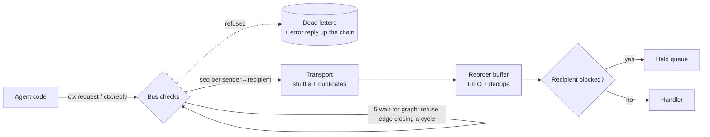

# typed-agent-contracts

A multi-agent message bus that treats agents as a distributed system. It has typed contracts (Pydantic → JSON Schema), per-channel ordering guarantees over a lossy transport, deadlock and delegation-cycle detection, delegation-depth limits, and per-agent trust levels that cannot be escalated through a trusted deputy. Scenario tests cover each failure, and a fuzzer compares the bus against baselines with each guard turned off.

## What it is
Agents talk only through the bus, and only through registered **contracts** (`name@version` with a request model, a reply model and a minimum trust level). The bus builds every envelope itself: sequence number, delegation chain and effective trust. An agent cannot forge them. Agent code gets a `ctx` with only two actions, `request` and `reply`, and both are tied to the message being handled.

## Why
Multi-agent systems fail like distributed systems, not like prompts:
- free-form messages carry smuggled fields and wrong types;
- networks and queues reorder and duplicate messages;
- agents that wait on each other deadlock;
- delegation loops (A → B → C → A) and runaway delegation depth burn budget;
- a low-trust agent (for example one that reads web pages) asks a high-trust agent to do something privileged for it. This is the confused-deputy problem.

## Architecture


## How it works
| Part | File | Rule |
|---|---|---|
| Contracts | [`tac/contracts.py`](tac/contracts.py) | Pydantic models with `strict=True, extra="forbid"`. `ContractRegistry.export()` emits JSON Schema per contract. Example contracts: `summarize`, `search`, `task` (min trust 0) and `payments.refund` (min trust 2). |
| Ordering | [`tac/bus.py`](tac/bus.py) | Sender side: a sequence number per (sender, recipient). Receiver side: a reorder buffer delivers seq *n* only after *n−1*; anything already seen is dropped as a duplicate. |
| Delegation | `tac/bus.py` | The chain comes from the parent envelope (`parent.chain + [parent.sender]`). Delegating from a message addressed to someone else is refused (`forged_parent`). The depth limit and the cycle check run on that chain. Errors propagate back up the chain to the root requester. |
| Deadlock | `tac/bus.py` | Blocking requests add `waiter → callee` edges. An edge that would close a cycle is refused with `deadlock` and the full cycle path; the other request completes. Single-threaded agents hold incoming requests while blocked and drain them after the reply arrives. |
| Trust | `tac/bus.py` | Effective trust = `min(trust)` over every agent in the chain, compared with the contract's `min_trust`. |

## Results
### Fuzzer — measured
Run: `python3 eval/run_fuzz.py`. Raw output: [`results/fuzz_results.json`](results/fuzz_results.json). 300 seeded trials. Each trial has 7 agents with random trust and random roles (sink / relay / refund-requester), 12 root requests, a shuffled transport with a 20% duplicate rate, max depth 3, and 10% invalid payloads. All three arms run the same seeds.

| Metric | Full bus | No ordering (no reorder buffer / dedupe) | No deadlock detection |
|---|---|---|---|
| FIFO violations | **0** | 724 | 0 |
| Duplicate deliveries | **0** | 1,569 | 0 |
| Requests hung forever (open waits at end) | **0** | 0 | 1,567 |
| Privileged refunds run with effective trust < 2 | **0** | 0 | 0 |
| Refunds executed | 40 | 48 (duplicates re-ran refunds) | 24 |
| Refused: deadlock / cycle / depth | 563 / 197 / 15 | 605 / 241 / 30 | — / 44 / 1 |
| Refused: invalid payload / trust | 352 / 799 | 352 / 987 | 352 / 410 |

How to read it: without the reorder buffer the same workload produces 724 out-of-order and 1,569 duplicate deliveries, and 8 extra refunds run. Without deadlock detection, 1,567 requests wait forever. The trust check is on in every arm, so no arm runs a low-trust refund. The `no_open_request` refusals (831 in the full arm) come from the fuzz workload itself: relay agents try to forward a reply for a root request that has no parent. Before the fix this crashed the bus. The fuzzer found that bug, and a regression test now covers it.

### Tests
22 tests, all passing (`python3 -m pytest -q`; summary in [`results/test_summary.txt`](results/test_summary.txt)):
- typed round trip;
- 4 invalid-payload cases (strict type, range, missing field, smuggled extra field), all rejected before delivery;
- unknown contract / not accepted;
- bad reply rejected;
- FIFO under a shuffled transport (200 messages), plus an unordered baseline that really reorders;
- duplicates dropped;
- delegation within the limit;
- depth limit exceeded (error reaches the root, no open waits);
- cycle `user->a->b->c->a`;
- 2-agent and 3-agent deadlocks;
- held requests processed after unblocking;
- direct trust violation;
- confused deputy blocked (and the same deputy allowed for a privileged caller);
- forged parent;
- JSON Schema export validates;
- the reply-without-request regression;
- eval gate.

## Run it
```bash
pip install pydantic jsonschema pytest
python3 -m pytest -q
python3 eval/run_fuzz.py
```

## Limits
- The bus is a single in-process, single-threaded simulation. The "network" is a shuffled list. There is no real broker (NATS, Kafka, Redis Streams) and no persistence. A bus restart loses sequence state.
- Ordering is per channel (sender → recipient), not causal or total ordering across channels.
- Deadlock detection sees only the blocking requests that go through the bus. Waits on external locks or tools are invisible to it. Detection refuses the request that closes the cycle; it does not choose a cheaper victim.
- Trust levels are static integers set at registration. There is no authentication of agent identity. In a real deployment, signed agent identities (mTLS, SPIFFE) would back the `sender` field.
- The fuzz workload is synthetic, and its role mix drives the refusal counts. The 0-vs-N comparisons are the point, not the absolute numbers.

## Stack
Python 3.12 · Pydantic v2 · jsonschema · pytest

## License
MIT
